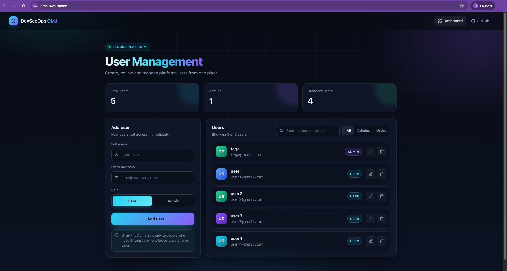
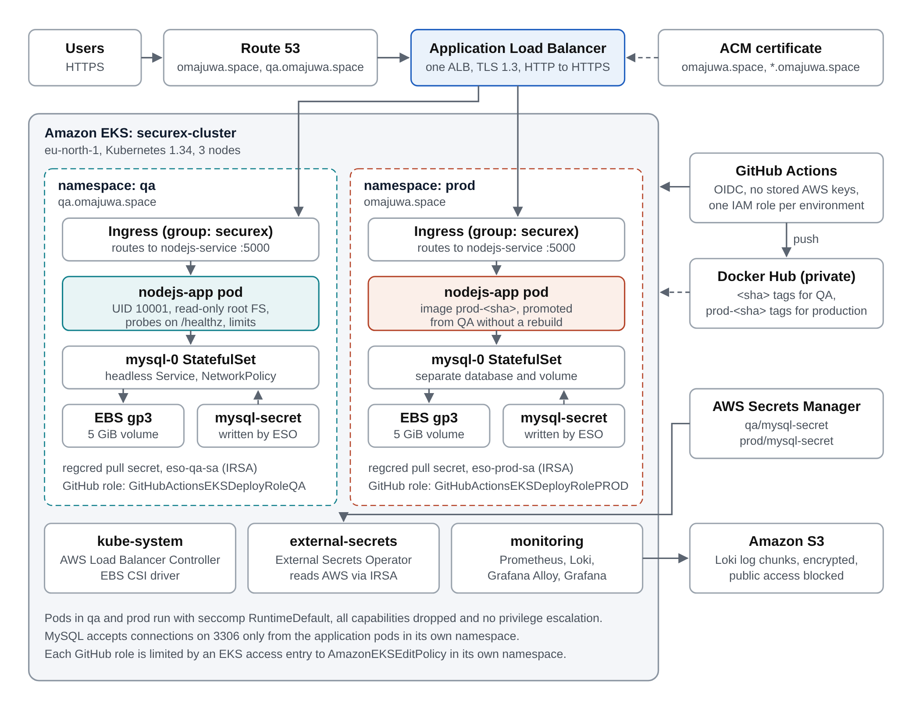
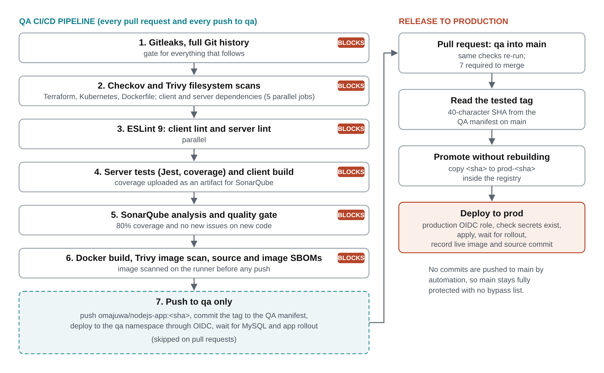
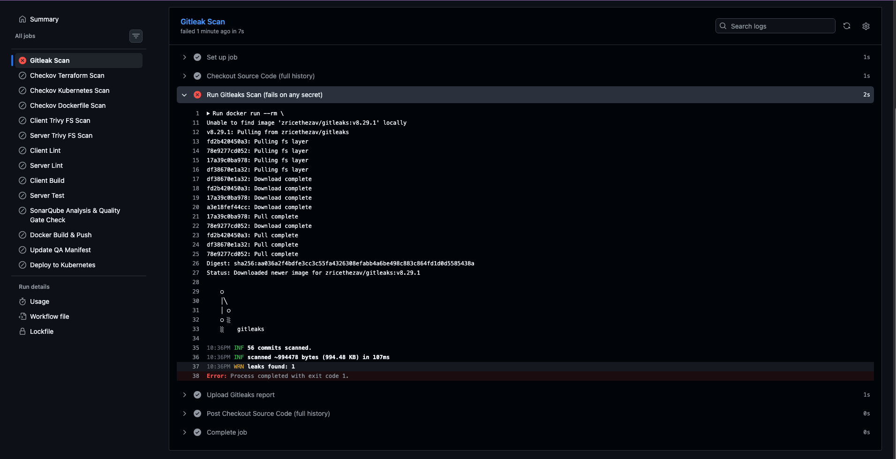
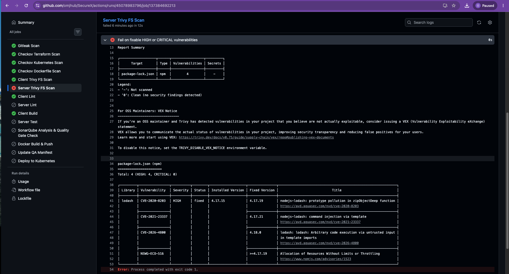
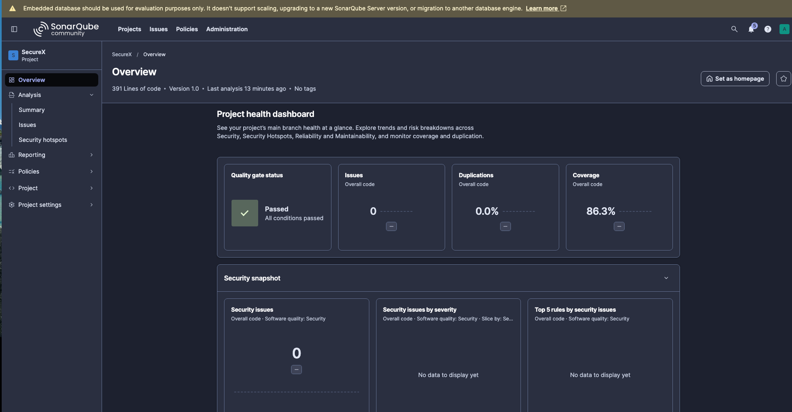
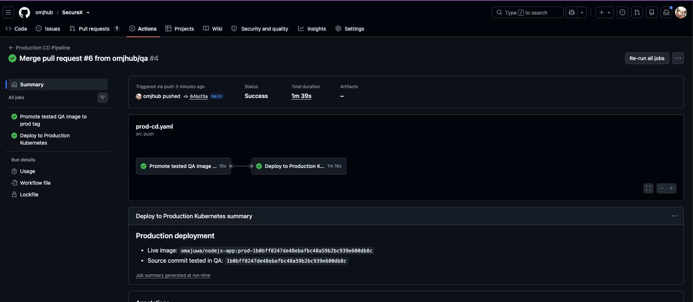
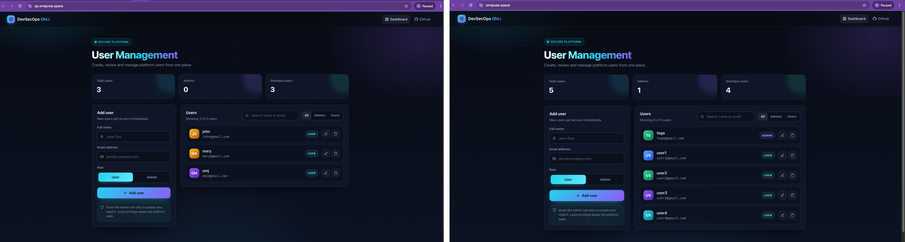

# SecureX: DevSecOps Platform on Amazon EKS


A containerised Node.js and MySQL application delivered to Amazon EKS through a GitHub Actions pipeline where every security check **blocks** a bad release instead of just reporting it. Production only ever runs the exact image that passed QA, promoted by commit SHA through a protected branch, with no long-lived cloud credentials anywhere.

📄 **[Read the full case study report (PDF)](docs/SecureX-Final-Case-Study-Report.pdf)**: architecture, design decisions, before and after results, challenges and lessons learned.



---

## Contents

- [Highlights](#highlights)
- [Architecture](#architecture)
- [CI/CD pipeline and security gates](#cicd-pipeline-and-security-gates)
- [Security gates proven](#security-gates-proven)
- [Release to production](#release-to-production)
- [Results](#results)
- [Tech stack](#tech-stack)
- [Repository structure](#repository-structure)
- [Running it yourself](#running-it-yourself)
- [Known limitations and roadmap](#known-limitations-and-roadmap)
- [Lessons learned](#lessons-learned)
- [Author](#author)

---

## Highlights

- **Blocking security gates.** Gitleaks (full Git history), Checkov (Terraform, Kubernetes, Dockerfile), Trivy (dependencies and image) and the SonarQube quality gate all fail the pipeline. The image is scanned on the runner before it is ever pushed.
- **Every gate proven by failing on purpose.** A fake API key, a vulnerable library and a failed quality gate were each used to show the pipeline stopping.
- **25 to 0 dependency vulnerabilities**, including a critical issue in `proxy-addr` and multiple advisories against axios 0.21.
- **31 unit and API tests** (Jest, Supertest) with **86.3% coverage** reported to SonarQube.
- **Isolated QA and production environments** on one EKS cluster, each with its own namespace, IAM role, MySQL database and secrets.
- **Build once, promote by SHA.** Production runs the byte-identical image QA tested, copied to a `prod-<sha>` tag without a rebuild.
- **Protected `main` branch.** Pull requests only, 7 required checks, direct pushes rejected.
- **No stored cloud keys.** GitHub OIDC for the pipeline; AWS Secrets Manager, External Secrets Operator and IRSA for database credentials.
- **Hardened runtime.** Non-root containers (UID 10001), read-only root filesystem, all capabilities dropped, seccomp, resource limits, health probes and NetworkPolicies.
- **Observability.** Prometheus, Loki, Grafana Alloy and Grafana for metrics and centralised logs.
- **Reproducible.** The whole platform is rebuilt from scripts in about 30 minutes and torn down completely to control cost.

---

## Architecture



- **Edge:** Route 53 resolves `omajuwa.space` (production) and `qa.omajuwa.space` (QA) to one Application Load Balancer, created by the AWS Load Balancer Controller from two Ingresses sharing the IngressGroup `securex`. The ALB terminates TLS with an ACM certificate, enforces a TLS 1.3 policy, redirects HTTP to HTTPS and health-checks `/healthz`.
- **Runtime:** a three-node managed node group (Kubernetes 1.34) in `eu-north-1`. Each namespace runs the Node.js application and a MySQL 8 StatefulSet on a 5 GiB EBS gp3 volume behind a headless Service.
- **Secrets:** External Secrets Operator reads `qa/mysql-secret` and `prod/mysql-secret` from AWS Secrets Manager through IRSA and writes each one only into its own namespace.
- **Platform namespaces:** `kube-system` (AWS Load Balancer Controller, EBS CSI driver), `external-secrets`, and `monitoring` (Prometheus, Loki, Alloy, Grafana, with Loki logs stored in an encrypted private S3 bucket).

### Key design decisions

| Decision | Why |
| --- | --- |
| GitHub OIDC instead of AWS access keys | Short-lived credentials per run; trust pinned to this exact repository and branch |
| One IAM role per environment | A QA run cannot assume the production role; each role is limited to its own namespace by an EKS access entry |
| Secrets Manager with External Secrets Operator | Credentials never enter Git or the pipeline; rotation and audit happen in one place |
| Build once, promote by commit SHA | Production runs exactly what QA tested, and every running version traces to a commit |
| Scan before push | A vulnerable image never reaches the registry |
| Two namespaces, one cluster, one ALB | Real isolation for data, secrets and permissions at the cost of a single cluster |
| Production pipeline never commits to `main` | Allows `main` to be fully protected with an empty bypass list |

---

## CI/CD pipeline and security gates



The QA pipeline ([`qa-cicd.yml`](.github/workflows/qa-cicd.yml)) runs **14 jobs** on every pull request and every push to `qa`. A full run on a push, including deployment, takes about **4 minutes 40 seconds**; pull request checks take about **3 minutes 20 seconds**.

| Stage | Jobs | Fails the run on |
| --- | --- | --- |
| 1. Secret scan | Gitleaks, full Git history | Any secret |
| 2. Static security scans | Checkov (Terraform, Kubernetes, Dockerfile), Trivy FS (client, server) | Any Checkov failure; a fixable HIGH or CRITICAL CVE |
| 3. Lint | ESLint 9 for client and server | Any lint error |
| 4. Test and build | Jest with coverage, client build | A failing test or build error |
| 5. Quality gate | SonarQube analysis and quality gate | Coverage below 80% or new issues on new code |
| 6. Image | Docker build, Trivy image scan, source and image SBOMs | A fixable HIGH or CRITICAL CVE in the image |
| 7. Release to QA (push only) | Push image, update QA manifest, deploy, verify rollout | A failed rollout |

**Design choices**

- Scanner versions are pinned (Gitleaks v8.29.1, Trivy v0.75.0, Checkov 3.2.334, SonarQube actions).
- Every scan uploads its report even when its job fails, so a blocked build still leaves the evidence needed to fix it.
- Images are tagged with the commit SHA that produced them.
- The QA pipeline commits the deployed tag to `k8-manifests/qa/app-deployment.yaml`, so the repository always shows what QA is running.
- Deploy jobs check their permissions with `kubectl auth can-i` before applying, and wait for MySQL and the application to roll out.

**Documented gate exceptions** (each written next to the code that relies on it):

- Checkov `CKV_K8S_43` (images by digest): images use immutable commit-SHA tags; signing and digest pinning are on the roadmap.
- Checkov `CKV_K8S_35` (secrets as environment variables): values come from External Secrets Operator and are read only at start-up.
- Seven MySQL-specific Checkov checks are skipped by annotation on the StatefulSet only, because the official MySQL image starts as root and needs a writable filesystem.
- Trivy `--ignore-unfixed`: findings with no available fix are reported but do not block.
- SonarQube coverage excludes the browser UI in `client/src` until browser tests exist.

---

## Security gates proven

A gate that has never failed is an assumption. Each one was tested with a deliberate failure on a throwaway branch, opened as a pull request and closed without merging.

**A fake API key: Gitleaks blocks the run and every later job is skipped.**



**lodash 4.17.15: Trivy blocks the run on 4 HIGH CVEs and lists the fixed version for each.**



**SonarQube:** the first run of the blocking quality gate failed at 30.2% coverage with 2 new issues. After adding tests and fixing the issues it passed with 86.3% coverage and 0 issues.



---

## Release to production

Production never rebuilds the application. After QA sign-off:

1. A pull request from `qa` into `main` re-runs the checks; 7 must pass to merge.
2. Merging runs the production pipeline ([`prod-cd.yaml`](.github/workflows/prod-cd.yaml)), which reads the 40-character commit SHA QA deployed from the QA manifest.
3. `docker buildx imagetools create` copies that image to `prod-<sha>` inside the registry, with no pull and no rebuild.
4. The job assumes the production OIDC role, checks that the pull secret and database secret exist in `prod`, deploys, waits for the rollout and records the live image and its source commit in the run summary.



QA and production run side by side with separate data:



---

## Results

| Metric | Before | After |
| --- | --- | --- |
| Security gates that block a release | 0 of 4 | 4 of 4 |
| Gates proven by a deliberate failure | 0 | 3 |
| Git history scanned for secrets | Latest commit | Full history |
| Known dependency vulnerabilities | 25 (1 critical, 12 high) | 0 |
| Automated tests | 0 | 31 |
| Test coverage in SonarQube | 0.0% | 86.3% |
| SonarQube open issues | 3 | 0 |
| Open code review findings | 7 | 1 (authentication, on the roadmap) |
| Production promotion | `latest` tag | Exact QA commit SHA |
| Production pipeline duration | 3m 20s | 1m 39s |
| Isolated environments | 1 | 2 (QA and production) |
| Required checks on `main` | None | 7 |

**Application fixes:** hard-coded fallback credentials removed (the app now refuses to start without its secrets), CORS removed, Helmet security headers and a Content Security Policy added, `X-Powered-By` disabled, server-side validation on every write, generic error messages to clients, a ReDoS-prone email regex replaced with a linear check, stored XSS fixed in the UI, and unused legacy code deleted.

---

## Tech stack

| Area | Tools |
| --- | --- |
| CI/CD | GitHub Actions |
| Secret scanning | Gitleaks |
| IaC and config scanning | Checkov |
| Vulnerability scanning | Trivy |
| Code quality and coverage | SonarQube |
| SBOM | Anchore Syft (SPDX) |
| Testing and lint | Jest, Supertest, ESLint 9 |
| Containers and registry | Docker, Buildx, Docker Hub (private) |
| Orchestration | Amazon EKS, eksctl, kubectl, Helm |
| Identity | GitHub OIDC, AWS IAM, EKS access entries, IRSA |
| Secrets | AWS Secrets Manager, External Secrets Operator |
| Networking and TLS | AWS Load Balancer Controller, ALB, Route 53, ACM |
| Storage | Amazon EBS (gp3) via the EBS CSI driver |
| Observability | Prometheus, Loki, Grafana Alloy, Grafana |
| Application | Node.js 20, Express, Helmet, MySQL 8, webpack |

---

## Repository structure

```
.
├── .github/workflows/
│   ├── qa-cicd.yml          # 14-job QA pipeline with blocking gates
│   └── prod-cd.yaml         # Promote the tested image by SHA to production
├── client/                  # Browser UI (webpack, ESLint)
├── server/
│   ├── server.js            # Express API and static file server
│   └── __tests__/           # Jest and Supertest tests
├── k8-manifests/
│   ├── qa/                  # Deployment, Service, Ingress, MySQL, NetworkPolicy
│   └── prod/                # Same pattern for production
├── scripts/
│   ├── rebuild.sh           # Recreate the cluster with qa and prod namespaces
│   └── teardown.sh          # Remove everything to stop AWS charges
├── docs/                    # Case study report and images
├── Dockerfile               # Multi-stage, non-root, production dependencies only
├── .checkov.yaml            # Documented Checkov exceptions
└── sonar-project.properties # SonarQube scope and coverage settings
```

---

## Running it yourself

### Run locally

Requires Node.js 20 and Docker.

```bash
# Start a local MySQL
docker run -d --name securex-db -p 3306:3306 \
  -e MYSQL_ROOT_PASSWORD=localroot -e MYSQL_DATABASE=securex \
  -e MYSQL_USER=app -e MYSQL_PASSWORD=localpass mysql:8.0

# Build the UI and start the API
cd client && npm ci && npm run build
cd ../server && npm ci
DB_HOST=127.0.0.1 DB_USER=app DB_PASSWORD=localpass DB_NAME=securex npm start
```

Open http://localhost:5000.

### Tests and lint

```bash
cd server && npm run lint && npm test
cd ../client && npm run lint
```

### Deploy to AWS

Prerequisites: an AWS account, AWS CLI, eksctl, kubectl and Helm; a domain in Route 53 with an ACM certificate in the same region; IAM roles for GitHub OIDC; and the database secrets `qa/mysql-secret` and `prod/mysql-secret` in Secrets Manager with the keys `MYSQL_ROOT_PASSWORD`, `MYSQL_DATABASE`, `MYSQL_USER` and `MYSQL_PASSWORD`.

```bash
export DOCKERHUB_USERNAME=<your-docker-hub-user>
read -s DOCKERHUB_TOKEN && export DOCKERHUB_TOKEN   # read-only access token
./scripts/rebuild.sh       # about 30 minutes
```

Then push to `qa` to deploy QA, merge `qa` into `main` to promote to production, and point the Route 53 records at the load balancer. When you are finished:

```bash
./scripts/teardown.sh
```

### GitHub configuration

| Name | Type | Purpose |
| --- | --- | --- |
| `AWS_ROLE_TO_ASSUME` | Secret | ARN of the QA deploy role (OIDC) |
| `AWS_ROLE_TO_ASSUME_PROD` | Secret | ARN of the production deploy role (OIDC) |
| `DOCKERHUB_TOKEN` | Secret | Docker Hub access token for pushing images |
| `SONAR_TOKEN` | Secret | SonarQube analysis token |
| `SONAR_HOST_URL` | Secret | SonarQube server URL |
| `DOCKERHUB_USERNAME` | Variable | Docker Hub username |

The environment is deployed on demand and torn down between sessions to control AWS cost; the pipeline runs and screenshots in this README and the [case study report](docs/SecureX-Final-Case-Study-Report.pdf) show it running.

---

## Known limitations and roadmap

| Priority | Item | Plan |
| --- | --- | --- |
| High | The API has no authentication | Add login and role checks so only administrators can change users |
| High | Grafana is served over plain HTTP | HTTPS on its own subdomain, restricted to known IP ranges |
| Medium | NetworkPolicies are defined but not enforced | Enable network policy support in the Amazon VPC CNI add-on |
| Medium | Loki reaches S3 through the node IAM role | Give Loki its own IRSA role |
| Medium | The browser UI has no automated tests | Add Playwright tests and include `client/src` in coverage |
| Medium | Images are referenced by tag, not digest | Sign with Cosign, deploy by digest, verify at admission |
| Low | Single MySQL replica with no backups | Amazon RDS or scheduled EBS snapshots |
| Low | Images stored in Docker Hub | Move production images to Amazon ECR with scan on push |
| Low | No runtime threat detection | Falco, plus application metrics and alert rules |

---

## Lessons learned

- **Identity failures are read, not guessed.** An OIDC trust policy mismatch was solved by reading the exact token subject from CloudTrail: GitHub now sends an immutable subject that includes numeric owner and repository IDs.
- **Regions matter.** An ALB can only use an ACM certificate from its own region.
- **A 503 is often DNS.** Application pods crashed with `ENOTFOUND mysql` because the StatefulSet had no headless Service.
- **A gate is only real once it has failed.** Making SonarQube blocking immediately exposed 30% coverage and then a ReDoS weakness nobody had noticed.
- **Full-history secret scanning covers every fetched branch.** A demo branch holding a fake key blocked an unrelated pull request until it was deleted, which is exactly the behaviour you want.
- **Release plumbing has edge cases.** A merge conflict left by old automated commits, a registry tag not readable straight after it was pushed, and a `[skip ci]` marker that would have silently skipped the checks protecting `main`.

The full detail of each challenge and its resolution is in the [case study report](docs/SecureX-Final-Case-Study-Report.pdf).

---

## Author

**Omajuwa Okotie**, DevSecOps and Cloud Security

- GitHub: [github.com/omjhub](https://github.com/omjhub)
- Previous project: [SecureFlow DevSecOps Pipeline](https://github.com/omjhub/SecureFlow-VulnerableCodebase)
